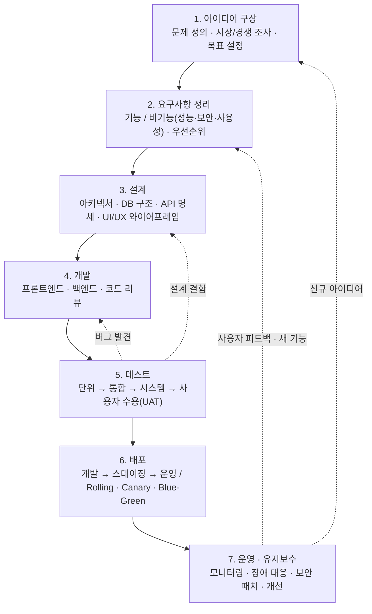

## 결론부터

웹 서비스 개발은 대체로 아래 일곱 단계로 정리된다.

- 아이디어 → 요구사항 → 설계 → 개발 → 테스트 → 배포 → 운영

자료 7편을 직접 열어 보니 단계 수는 4~7개로 제각각이었다. 순서는 거의 같았고, **갈리는 자리는 배포였다.** 영문 자료 4편 중 3편은 배포를 운영이나 다른 단계에 합쳤고, 국문 자료 3편은 모두 배포를 독립된 단계로 뒀다.

그리고 일곱 단계는 한 방향으로만 흐르지 않는다. 테스트에서 버그가 나오면 개발로, 운영에서 피드백이 오면 요구사항으로 돌아간다.

출처 7편은 대부분 외주 개발사나 개인 블로그다. 업계 표준 문서가 아니라 실무 자료의 공통분모를 정리한 것으로 읽어야 한다.

## 일곱 단계는 문제 정의에서 시작해 운영에서 다시 앞으로 돌아간다

점선은 피드백 루프(다음 단계의 결과를 보고 앞 단계를 다시 하는 반복)다.

단계마다 요점은 하나씩이다.

- 요구사항 — 기능 요구사항(시스템이 할 일)과 비기능 요구사항(성능·보안·사용성)으로 나눈다
- 설계 — 요구사항을 바탕으로 아키텍처, DB 구조, 화면 흐름, API 명세를 잡는다
- 테스트 — 범위를 좁은 것에서 넓은 것으로 넓힌다. [velog 의 DevOps 글](https://velog.io/@bienlee/DevOps-개발-프로세스)은 단위 → 통합 → 시스템 순서를 들고, [TECHVIFY 국문 글](https://techvify.com/kr/software-development-process)은 여기에 사용자 수용 테스트(UAT)까지 네 종류를 언급한다. 네 개를 한 줄로 이은 순서는 두 글을 합친 내 정리다
- 배포 — 환경을 거쳐 운영에 올린다. 무중단 배포(서비스를 멈추지 않고 새 버전으로 바꾸는 방식)가 여기 들어간다
- 운영 — 배포가 끝이 아니다. 모니터링과 장애 대응, 개선이 이어진다

아이디어와 요구사항 단계에서 쓰는 용어(페르소나, PRD, 우선순위 기법 등)는 [서비스 기획 용어 정리](/Planning/서비스-기획-용어-17개는-쓰이는-단계로-나누면-안-헷갈린다.html)에 따로 모았다.

## 자료 7편을 나란히 놓으면 단계 수가 4~7개로 갈린다

각 자료가 실제로 적은 단계를 옮기면 이렇다.

| 자료 | 단계 수 | 단계 | 배포 |
|---|---|---|---|
| [Redberries](https://redberries.ae/a-complete-guide-to-the-7-phases-of-web-development-life-cycle) | 7 | 조사 → 기획 → 디자인 → 콘텐츠 제작 → 개발 → 테스트 → 유지보수 | 유지보수에 합침 ("Maintenance and Deployment") |
| [Monocubed](https://www.monocubed.com/web-development-life-cycle) (2026-05 갱신) | 7 | 조사·분석 → 기획·전략 → 디자인·와이어프레임 → 콘텐츠 제작 → 개발 → 테스트·QA → 배포·유지보수 | 유지보수에 합침 |
| [TECHVIFY 영문](https://techvify.com/web-development-life-cycle) (2024-08) | 6 | 조사·요구사항 수집 → 전략 기획 → 디자인·레이아웃 → 개발 → 테스트·QA → 유지보수·업데이트 | 단계로 두지 않음 |
| [Educative](https://www.educative.io/answers/what-are-the-steps-involved-in-a-website-development-lifecycle) | 7 | 정보 수집 → 기획·분석 → 구현 → 출시 → 테스트 → 마케팅 → 유지보수 | 독립 단계 ("Launch") |
| [velog, bien](https://velog.io/@bienlee/DevOps-개발-프로세스) (2025-03) | 4 + 4 | 요구사항 분석 → 와이어프레임 → 설계 → 구현 / 빌드 → 테스트 → 배포 → 모니터링 | 독립 단계 |
| [tilnote](https://tilnote.io/pages/6a2af4b4feda101b0a96542b) (2026-06) | 6 | 요구사항 정리 → 화면 설계 → 개발 → 테스트 → 배포 → 운영 | 독립 단계 |
| [TECHVIFY 국문](https://techvify.com/kr/software-development-process) (2023-06) | 6 | 요구사항 수집 → 기획·설계 → 개발 → 테스트·QA → 배포 → 유지보수·지원 | 독립 단계 (같은 글의 FAQ 는 "배포 및 유지보수"로 합침) |

표에서 보이는 것이 셋 있다.

첫째, **순서는 거의 같다.** 조사·요구사항이 앞에, 유지보수가 맨 뒤에 온다. 예외는 Educative 하나다. 출시(Launch)를 테스트보다 앞에 둔다.

둘째, **영문 자료 둘에만 "콘텐츠 제작" 단계가 있다.** Redberries 와 Monocubed 는 웹사이트 제작 가이드라 글과 이미지를 채우는 일이 한 단계를 차지한다. 이 단계를 빼면 웹 서비스의 일곱 단계와 거의 겹친다. 이 해석은 내 것이다.

셋째, 배포의 자리가 갈린다. 다음 절에서 본다.

## 갈리는 자리는 배포다

영문 자료 4편 중 3편은 배포를 따로 세지 않는다. Monocubed 는 QA 승인을 받으면 "드디어 배포할 준비가 된다"고 쓰지만, 단계 이름은 "배포·유지보수" 하나다. TECHVIFY 영문 글은 배포라는 단계 자체가 없다.

국문 자료 3편은 모두 배포를 독립 단계로 둔다. 그중 velog 글이 가장 자세하다.

- 환경 — Dev, UAT, Staging, Prod 로 나눠 차례로 올린다
- Rolling — 인스턴스를 하나씩 새 버전으로 교체한다
- Canary — 일부 트래픽으로 먼저 검증하고 단계적으로 전환한다
- Blue-Green — 기존 환경과 새 환경을 나란히 두고 트래픽을 한 번에 전환한다. 자원이 두 배 필요해 비용이 더 든다

tilnote 글은 웹과 앱의 차이를 짚는다. 웹은 서버에 반영하면 되지만, 앱은 앱스토어 심사나 업데이트 배포가 필요할 수 있다.

같은 회사의 두 글도 갈린다. TECHVIFY 의 영문 웹 개발 글에는 배포 단계가 없고, 국문 소프트웨어 개발 글에는 있다. 다만 두 글은 주제가 다르다(웹 개발 생애주기와 소프트웨어 개발 프로세스). 그래서 이것을 언어 차이의 증거로 보기는 어렵다.

**자료 7편이라 경향이라고 부르기도 조심스럽다.** 다만 배포를 따로 세는 자료가 무중단 배포와 환경 구분까지 다루는 것은 분명하다. 배포를 유지보수에 넣는 자료는 "올린다"는 한 문장으로 지나간다.

## 단계마다 남는 문서가 있다

아래 표는 자료 한 편에서 가져온 것이 아니라, 각 단계의 일반적인 산출물을 내가 정리한 것이다.

| 단계 | 대표 산출물 |
|---|---|
| 아이디어·요구사항 | 기획서, 요구사항 명세서, 백로그 |
| 설계 | 아키텍처 다이어그램, ERD, API 명세, 화면 설계서 |
| 개발·테스트 | 소스 코드, PR, 테스트 코드와 결과 리포트 |
| 배포·운영 | CI/CD 파이프라인, 모니터링 대시보드, 장애 보고서 |

## 그럼 일곱 단계를 순서대로 한 번씩 밟으면 되나

그렇지 않다. tilnote 글은 실제 현장에서 단계가 직선으로만 진행되지 않는다고 쓴다. 테스트 중에 설계로 돌아가기도 하고, 운영 중에 요구사항을 다시 정리하기도 한다. 위 도식의 점선이 그 경로다.

같은 글은 일정이 늦어지는 대표 원인의 첫 번째로 **요구사항 변경**을 든다. 기능 방향이 바뀌면 이미 만든 화면, 데이터 구조, 서버 로직을 다시 고쳐야 할 수 있기 때문이다. 그 밖의 원인으로는 숨은 오류, 외부 연동 문제, 결정 지연을 든다.

이 원인은 위 도식의 점선과 이어진다. 점선이 길수록, 즉 뒤 단계에서 앞 단계로 멀리 돌아갈수록 다시 고칠 것이 많다. 운영에서 요구사항으로 돌아가는 화살표가 가장 비싼 이유다. 이 연결은 내 해석이다.

## 이 정리의 한계

- 출처 7편 중 업계 표준 문서는 없다. 외주 개발사 블로그 4편, 학습 사이트 1편, 개인 블로그 1편, 책을 옮긴 노트 1편이다
- 영문·국문의 차이는 7편에서 본 것이다. 더 많은 자료에서도 그런지는 확인하지 않았다
- Redberries 와 Educative 는 작성자와 작성일이 없다
- 산출물 표와 테스트 네 단계의 순서는 내 정리다

## 정리

| 질문 | 답 |
|---|---|
| 몇 단계인가 | 자료마다 4~7개. 일곱 단계로 묶으면 아이디어 → 요구사항 → 설계 → 개발 → 테스트 → 배포 → 운영 |
| 어디서 갈리나 | 배포. 영문 4편 중 3편은 합치고, 국문 3편은 모두 따로 센다 |
| 순서대로만 가나 | 아니다. 테스트·운영에서 앞 단계로 돌아간다 |
| 일정이 왜 밀리나 | 대표 원인은 요구사항 변경이다. 뒤에서 앞으로 돌아갈수록 다시 할 일이 많다 |

## 출처

- [A Complete Guide to the 7 Phases of Web Development Life Cycle](https://redberries.ae/a-complete-guide-to-the-7-phases-of-web-development-life-cycle) — Redberries
- [Web Development Life Cycle](https://www.monocubed.com/web-development-life-cycle) — Monocubed, Yuvrajsinh Vaghela
- [Web Development Life Cycle](https://techvify.com/web-development-life-cycle) — TECHVIFY
- [What are the steps involved in a website development lifecycle?](https://www.educative.io/answers/what-are-the-steps-involved-in-a-website-development-lifecycle) — Educative
- [DevOps 개발 프로세스](https://velog.io/@bienlee/DevOps-개발-프로세스) — velog, bien
- [tilnote 노트](https://tilnote.io/pages/6a2af4b4feda101b0a96542b) — 「일반인이 쉽게 이해하는 개발 지식」 정리
- [소프트웨어 개발 프로세스](https://techvify.com/kr/software-development-process) — TECHVIFY
