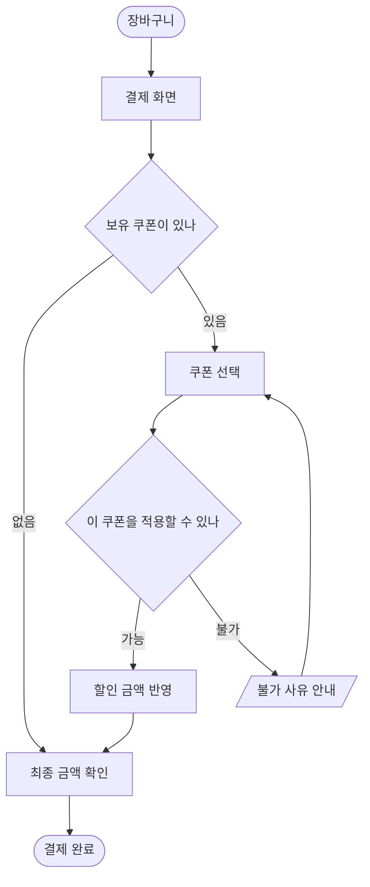

## 결론부터

[1편](/Planning/서비스-기획-용어-17개는-쓰이는-단계로-나누면-안-헷갈린다.html)에서 해법 설계 단계로 묶은 문서 가운데 셋을 이 글에서 다룬다. 셋은 같은 기능을 서로 다른 질문으로 자른다.

- 유저 플로우 — 화면 **사이**: 사용자가 작업을 끝내기까지 어떤 단계와 분기를 거치나
- 와이어프레임 — 화면 **안**: 한 화면에 무엇을 어디에 놓나
- 정책서 — 화면과 **무관한 규칙**: 무엇이 허용되고, 예외에서는 어떻게 되나

와이어플로우는 앞의 두 장을 한 장에 붙인 형식이고, 화면설계서·스토리보드는 셋을 한 문서에 묶어 부르는 한국 업계의 이름에 가깝다.

**그림 두 장은 "어디로 가고 무엇이 보이나"를 말하지만 "무엇이 허용되나"는 말하지 않는다.** 유저 플로우의 분기 마름모 안에 적힌 질문에 답하는 문서가 따로 필요하고, 한국 업계는 그걸 정책서라고 부른다.

유저 플로우, 와이어프레임, 와이어플로우는 NN/g 글에서 정의를 가져왔다. 정책서와 화면설계서는 이번에도 표준 정의를 찾지 못했다. 그 둘은 실무자 글 몇 편에서 쓰임새를 확인한 데까지만 쓴다. 예시로 드는 배달앱 쿠폰 기능은 설명을 위해 지어낸 것이다.

## 유저 플로우는 한 제품 안의 짧은 작업 하나를 그린다

NN/g 의 Kate Kaplan 은 [2023년 글](https://www.nngroup.com/articles/user-journeys-vs-user-flows/)에서 유저 플로우를 흔한 작업 하나를 끝내는 데 필요한 "전형적이거나 이상적인 단계들을 기술하는 상호작용의 집합(a set of interactions that describe the typical or ideal set of steps needed to accomplish a common task)"으로 정의한다.

같은 글은 유저 플로우를 유저 저니와 나란히 놓고 비교한다. 정리하면 이렇다.

| 구분 | 유저 저니 | 유저 플로우 |
|---|---|---|
| 범위 | 여러 채널·접점에 걸친다 | 제품 하나 안의 상호작용 |
| 시간 | 며칠, 몇 주, 몇 달 | 몇 분, 몇 시간 안에 끝나는 목표 |
| 담는 것 | 행동, 감정, 생각, 채널 | 주요 사용자 행동과 시스템의 응답. 감정은 없다 |
| 산출물 | 저니맵 | 와이어플로우, 플로차트, 태스크 다이어그램 |
| 맞는 조사 | 현장 조사, 일기 연구 | 사용성 테스트 |

글에 나오는 예가 차이를 잘 보여준다. 새 병원을 찾고 예약하고 진료받고 후속 연락을 받기까지가 유저 저니다. 그 안에서 환자 포털로 검사 결과를 보는 일 하나가 유저 플로우다.

저니맵 쪽 정의는 Sarah Gibbons 의 [2018년 글](https://www.nngroup.com/articles/journey-mapping-101/)에 있다. 저니맵은 사람이 목표를 이루려고 거치는 과정을 시각화한 것이고, 행위자, 시나리오와 기대, 여정 단계, 행동·생각·감정, 기회라는 다섯 요소를 공통으로 가진다. 감정과 기회가 칸으로 있다는 점이 유저 플로우와 가장 크게 다르다.

배달앱의 쿠폰 적용을 유저 플로우로 그리면 아래와 같다. 지어낸 예다.



화면 이동과 분기는 이 한 장으로 끝난다. 그런데 **"이 쿠폰을 적용할 수 있나" 마름모는 질문만 적고 답의 기준은 적지 않는다.** 최소 주문 금액 때문인지, 다른 쿠폰과 겹쳐서인지, 만료돼서인지는 플로우에 없다. 그건 플로우가 모자라서가 아니라 원래 담는 층이 아니라서다. 이 판단은 내 해석이다.

흔한 오해는 유저 플로우와 저니맵을 같은 그림의 크기 차이로 보는 것이다. 위 표대로 둘은 조사 방법부터 다르다. 저니맵은 사용자가 어떤 감정으로 어디서 이탈하는지를 찾는 도구이고, 유저 플로우는 제품 안의 경로를 빠짐없이 그리는 도구다.

## 와이어프레임은 화면 안을 그리고, 충실도는 정도의 문제다

NN/g 의 Page Laubheimer 는 [2016년 글](https://www.nngroup.com/articles/wireflows/)에서 와이어프레임을 "페이지 단위의 배치 아이디어(page-level layout ideas)"를 보여주는 흔한 산출물로 소개한다. 한계도 같은 글에 있다.

- 배치는 잘 보여주지만 상호작용은 잘 설명하지 못한다
- 페이지 이동 없이 내용이 바뀌는 동적인 앱에서 특히 약하다
- 사용자가 동작한 뒤 받는 시스템 피드백을 놓치기 쉽다

같은 쿠폰 기능의 결제 화면을 와이어프레임으로 옮기면 이렇다. 역시 지어낸 예다.

```text
[ ← 결제하기 ]
------------------------------------
주문 메뉴          (메뉴 목록)
------------------------------------
쿠폰              [ 쿠폰 선택  > ]
                  (적용 불가 사유 자리)
------------------------------------
주문 금액
쿠폰 할인          - (할인액)
최종 결제 금액
------------------------------------
[            결제하기            ]
```

이 그림은 "적용 불가 사유가 쿠폰 버튼 바로 아래에 회색으로 나온다"까지는 말한다. 어떤 사유가 있는지, 사유가 둘 겹치면 무엇을 먼저 보여주는지는 말하지 않는다.

충실도(fidelity)는 와이어프레임 글에서 자주 나오는 구분이다. 다만 NN/g 에서 이 구분을 정면으로 다룬 글은 와이어프레임이 아니라 프로토타입에 관한 것이다. Kara Pernice 의 [2016년 글](https://www.nngroup.com/articles/ux-prototype-hi-lo-fidelity/)은 충실도를 최종 시스템의 겉모습과 느낌에 얼마나 가까운지로 보고, 세 축으로 나눈다.

- 상호작용 — 저충실도는 눌러도 동작하지 않고, 고충실도는 많은 곳이나 전부가 눌린다
- 시각 — 저충실도는 최종 화면의 시각 속성을 일부만 담거나 아예 담지 않는다
- 내용 — 저충실도는 내용을 요약하거나 자리만 잡는다

와이어프레임은 이 글에서 저충실도 시각의 예로 한 번 나온다("a black-and-white sketch or wireframe"). 모든 와이어프레임을 저충실도로 분류하지는 않는다. Laubheimer 도 와이어플로우가 저충실도일 수도 고충실도일 수도 있다고 쓴다.

그래서 **저충실도와 고충실도는 문서 종류가 아니라 같은 문서의 정도다.** 위 텍스트 그림도 와이어프레임이고, 색과 실제 문구를 입힌 것도 와이어프레임이다. "고충실도 와이어프레임"과 "디자인 시안"의 경계를 정한 1차 출처는 찾지 못했다.

## 와이어플로우는 둘을 붙인 명세 형식이다

같은 Laubheimer 글이 와이어플로우를 정의한다. 와이어프레임식 페이지 배치에 플로차트식의 단순한 상호작용 표현을 붙인 "디자인 명세 형식(design-specification format)"이다.

글이 든 출발점은 이렇다.

- 플로차트는 여러 단계와 경로가 있는 작업 흐름을 빠짐없이 기록하는 데 좋지만, 상호작용이 일어나는 화면 맥락을 뺀다
- 와이어프레임은 반대로 화면은 있지만 상호작용이 없다
- 와이어플로우는 모바일 앱 설계에서 시작했다. 플로차트의 한 단계가 화면 하나다
- 데스크톱에서는 보통 화면 전체 대신 바뀌는 부분만 그린다

맞는 자리와 안 맞는 자리도 글에 있다. 앱 안의 한두 화면에서 내용이 동적으로 바뀌는 것을 보여주기에 잘 맞는다. 정적인 페이지 여러 개가 링크로 이어진 흐름에는 덜 맞고, 정적인 데스크톱 사이트를 와이어플로우로 문서화하는 것은 조심하라고 쓴다.

쿠폰 예에 대입하면 결제 화면 위로 쿠폰 선택 창이 열리고, 고른 쿠폰에 따라 할인액이 바뀌거나 사유가 뜨는 장면이 와이어플로우가 맞는 자리다. 화면 하나 안에서 상태가 여러 번 바뀌기 때문이다. 이 대입은 내 해석이다.

와이어플로우도 마름모의 기준은 적지 않는다. "불가 사유 안내" 화면을 그릴 수는 있어도, 어떤 경우에 그 화면으로 가는지는 다른 데 있어야 한다.

## 정책서는 화면이 아니라 규칙을 적는다

정책서는 1편에서도 공식 정의를 찾지 못했다. 이번에 국내 실무자 글과 책 소개를 더 찾아봤지만 표준 정의는 없었다. 대신 **같은 내용을 어느 문서에 적는지가 사람마다 다르다**는 것이 확인됐다.

- 프리랜서 기획자 제이미의 [2024년 글](https://letter.wepick.kr/post/2756)은 "서비스 정책서"라는 말을 쓰지만 정의하지는 않는다. 정책서에서 가장 신경 쓸 것으로 용어의 일관성을 꼽는다. 마이페이지 정책에는 "쿠폰 발행"이라 적고 홈에서는 "할인권 지급"이라 부르면 새로 온 사람은 둘을 다른 것으로 오해한다는 예를 든다
- 박장훈의 [2026년 글](https://brunch.co.kr/@ededd69d0795454/9)은 예외 처리를 셋으로 나누고 적는 곳도 따로 둔다. 정산 금액이 마이너스로 나오는 것 같은 비즈니스 예외는 PM 이 정해 PRD 의 규칙 섹션에 적는다. 검색 결과가 없을 때의 문구 같은 UI 예외는 디자인 옆에 적는다. API 호출 실패 같은 시스템 예외는 PRD 에 대원칙만 적고 세부는 개발자가 코드와 API 명세에서 정한다. 이 글에는 정책서라는 말이 나오지 않는다
- [교보문고에 소개된 2026년 책 『서비스 기획자 요구사항 정리법』](https://ebook-product.kyobobook.co.kr/dig/epd/ebook/E000012857852)은 소개와 목차에서 "정책설계", "요구사항정의서"라는 말을 쓰고 "정책서"는 쓰지 않는다. 본문은 읽지 않았다

세 자료를 겹치면, 규칙을 적는 일 자체는 모두 하지만 그 문서의 이름과 위치는 정해져 있지 않다. 이 글에서 정책서라고 부르는 것은 **화면과 무관하게 서비스 전체에 걸리는 규칙을 모은 문서**라는 쓰임새 기준의 뜻이다.

같은 쿠폰 기능의 정책서를 표로 지어내면 이렇다. 각 행이 누군가 내려야 하는 결정 하나다.

| 항목 | 규칙 (지어낸 예) |
|---|---|
| 중복 적용 | 주문 하나에 앱 쿠폰 한 장과 가게 쿠폰 한 장까지 함께 쓴다 |
| 적용 조건 | 쿠폰마다 최소 주문 금액이 있고, 배달비는 주문 금액에 넣지 않는다 |
| 정률 할인 | 할인액에 상한을 둔다 |
| 전체 취소 | 배달 전에 취소하면 쿠폰을 사용 가능 상태로 되돌린다 |
| 만료 후 취소 | 취소 시점에 유효기간이 지났으면 되돌리지 않는다 |
| 부분 취소 | 남은 금액이 최소 주문 금액보다 작아져도 이미 받은 할인은 유지한다 |
| 동시 결제 | 같은 쿠폰으로 두 주문을 동시에 결제하면 먼저 확정된 주문만 쿠폰을 쓴다 |
| 불가 사유 표시 | 사유가 여럿이면 만료 → 최소 금액 → 중복 순으로 하나만 보여준다 |

앞의 그림들과 비교하면 역할이 갈린다. 플로우의 "이 쿠폰을 적용할 수 있나" 마름모에 대한 답이 위쪽 세 행이다. 와이어프레임의 "적용 불가 사유 자리"에 무엇을 보여줄지가 마지막 행이다. 취소, 만료, 동시 결제 행은 어느 그림에도 나오지 않는다. 결제 화면을 아무리 자세히 그려도 취소한 뒤의 일은 화면에 없기 때문이다.

흔한 오해는 정책서를 화면 설명의 부록으로 보는 것이다. 취소 시 복구 규칙은 결제 화면에도 주문 내역 화면에도 쿠폰함 화면에도 걸린다. 화면마다 따로 적으면 제이미의 예처럼 같은 규칙이 다른 말로 흩어진다. 화면과 따로 두는 이유가 여기 있다고 나는 본다.

## 정책서의 행은 결국 서버의 상태와 검증이 된다

이 섹션은 전부 내 해석이다. 기획 문서를 쓰는 쪽이 아니라 그것을 받아 구현하는 백엔드 개발자의 눈으로 본 것이다.

위 표를 서버 쪽 말로 옮기면 거의 한 줄씩 대응한다.

```text
정책서의 행        서버에서 되는 것
중복 적용         주문 생성 API 의 입력 검증
적용 조건         같은 검증. 배달비를 뺀 금액으로 비교
전체 취소         쿠폰 상태 전이 USED → ISSUED. 주문 취소와 같은 트랜잭션
만료 후 취소      같은 전이의 분기 USED → EXPIRED
동시 결제         쿠폰 행 잠금이나 조건부 UPDATE
불가 사유 표시    검증 실패를 사유 코드로 돌려주는 응답 형식
```

와이어프레임과 유저 플로우는 대부분 클라이언트 화면이 된다. 정책서의 행은 대부분 서버의 상태와 검증이 된다. 이 차이가 중요한 이유는 **화면에서 막은 규칙은 규칙이 아니기 때문이다.** 적용 불가 쿠폰의 버튼을 회색으로 만들어도 API 를 직접 부르면 그 화면은 지나간다. 규칙은 서버가 지켜야 하고, 서버가 지키려면 규칙이 화면 밖에 적혀 있어야 한다.

동시 결제 행이 특히 그렇다. 화면을 그리는 사람에게는 잘 떠오르지 않는 경우지만, 서버에서는 아래처럼 한 줄의 조건으로 나타난다.

```sql
-- 쿠폰을 쓸 때, 아직 발급 상태인 경우에만 사용 처리한다
UPDATE coupon
   SET status = 'USED', order_id = :orderId
 WHERE id = :couponId
   AND status = 'ISSUED';
-- 갱신된 행이 0이면 다른 주문이 먼저 썼다는 뜻이다. 이 주문의 쿠폰 적용은 실패시킨다
```

정책서에 동시 결제 행이 없으면 이 판단은 사라지지 않는다. 개발자가 코드 안에서 조용히 내린다. 박장훈이 시스템 예외의 세부를 개발자에게 위임한다고 쓴 것과 같은 구조다. 다만 그 글은 비즈니스 예외만큼은 PM 이 정해 문서에 박아야 한다고 선을 긋는다. 쿠폰을 돌려주느냐 마느냐는 돈이 걸린 비즈니스 결정이라 그 선의 안쪽이라고 나는 본다.

규칙을 받아 실제로 동작하는지 확인할 기준으로 바꾸는 일, 즉 유저 스토리와 인수 조건은 6편의 범위다.

## 화면설계서와 스토리보드는 셋을 한 문서에 묶은 이름에 가깝다

화면설계서와 스토리보드도 표준 정의를 찾지 못했다. 확인한 것은 실무 글 한 편이다.

이랜서 블로그의 [2022년 글](https://www.elancer.co.kr/blog/detail/66)은 개인 작성자 이름 없이 "IT 업계 20년 기획자의 실전 노하우"라는 설명만 단다. 이 글은 스토리보드를 "웹/앱 서비스 개발을 위해 UX 측면에서 시각적으로 표현한 청사진이자 기획서"로 쓰고, 화면설계서를 같은 문서의 다른 이름으로 본다. 작성 순서로 든 구성은 아래와 같다.

- 표지, 작업 히스토리, 목차, 개요
- 메뉴 구조도(IA, Information Architecture, 정보 구조)
- 화면 ID 목록
- 플로우차트 — 화면 전환을 나타내는 흐름도. 화면이 단순하면 생략할 수 있다
- 정책 — 플로우차트와 묶어 쓰면 좋다고 한다. 같은 화면에서 사용자 동작에 따라 보이는 정보가 다르면 그 노출 정책을, 계정 성격에 따라 할 수 있는 일이 다르면 권한 정책을 적는다

이 구성대로라면 화면설계서 하나 안에 유저 플로우, 화면별 와이어프레임, 정책이 다 들어 있다. 반면 앞의 박장훈 글은 규칙을 PRD 에, UI 예외를 디자인 옆에 나눠 둔다. 자료 둘 다 한 사람의 관행이라 어느 쪽이 업계 표준이라고 말할 근거는 없다.

그래서 화면설계서라는 문서를 받으면 이름보다 **정책이 그 안에 있는지, 따로 있는지, 아예 없는지**를 먼저 보는 것이 맞다고 생각한다. 이것도 내 해석이다.

## 그럼 와이어플로우가 있으면 유저 플로우와 와이어프레임은 따로 안 그리나

그렇지 않다. 와이어플로우를 소개한 Laubheimer 의 글이 스스로 한계를 적는다. 정적인 페이지가 많이 이어진 흐름에는 덜 맞는다. 화면 맥락이 없는 플로차트는 여전히 여러 경로를 빠짐없이 기록하는 데 쓰이고, 같은 글은 플로차트가 백엔드 처리 흐름을 그리는 데도 쓰인다고 적는다.

유저 플로우를 그린다고 저니맵이 필요 없어지지도 않는다. Kaplan 의 글은 둘을 대체 관계가 아니라 줌의 차이로 놓는다. 여러 채널과 긴 시간에 걸친 경험이면 저니, 제품 하나 안의 짧은 작업이면 플로우다.

그리고 셋 중 어느 그림도 정책서를 대신하지 못한다. 와이어플로우는 화면 사이와 화면 안을 한 장에 담지만, 둘 다 화면에 대한 그림이다. 취소 후 쿠폰 복구처럼 화면이 없는 규칙은 여전히 다른 문서에 적혀야 한다.

## 원전을 찾지 못한 것과 확인하지 못한 것

- 정책서, 화면설계서, 스토리보드의 표준 정의를 찾지 못했다. 이 글의 설명은 실무 글 몇 편의 쓰임새 기준이다. 실무 글은 각자의 관행이고, 이랜서 글은 작성자 이름이 없다
- 유저 플로우와 와이어프레임이라는 말을 누가 처음 썼는지는 찾지 못했다. 정의는 NN/g 글에서만 가져왔다
- 와이어프레임의 저충실도·고충실도 구분을 정의한 1차 출처는 찾지 못했다. 충실도의 세 축은 NN/g 의 프로토타입 글에서 가져왔다
- 『서비스 기획자 요구사항 정리법』은 서점 소개와 목차만 봤다
- 정책서 예시 표와 서버 매핑, SQL 은 내가 지어낸 예다. 실제 서비스의 쿠폰 정책이 아니다

## 정리

같은 쿠폰 적용 기능이 문서마다 다른 질문에 답한다.

| 문서 | 묻는 질문 | 쿠폰 예에서 답하는 것 | 정의를 가져온 곳 |
|---|---|---|---|
| 유저 플로우 | 화면 사이를 어떻게 지나가나 | 결제 화면 → 쿠폰 선택 → 반영 또는 사유 안내 | NN/g, Kaplan |
| 와이어프레임 | 한 화면에 무엇을 어디에 두나 | 쿠폰 버튼 아래 사유 자리, 할인액 줄 | NN/g, Laubheimer |
| 와이어플로우 | 한 화면 안의 상태가 동작에 따라 어떻게 바뀌나 | 쿠폰 선택 창이 열리고 할인액이 바뀌는 장면 | NN/g, Laubheimer |
| 정책서 | 무엇이 허용되고 예외에서는 어떻게 되나 | 중복, 최소 금액, 취소 시 복구, 동시 결제 | 표준 정의 없음 |
| 화면설계서 | 위 문서들을 한 묶음으로 넘기면 | 회사마다 정책 포함 여부가 다르다 | 표준 정의 없음 |

유저 플로우의 마름모는 질문을 남기고, 정책서가 그 질문에 답한다. 백엔드 쪽에서 보면 그 답이 서버의 검증과 상태 전이로 옮겨진다.
